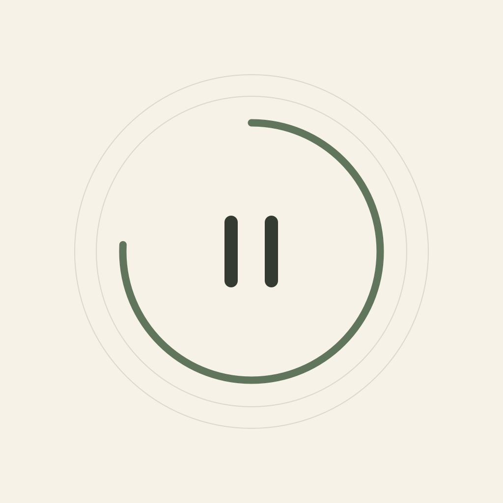
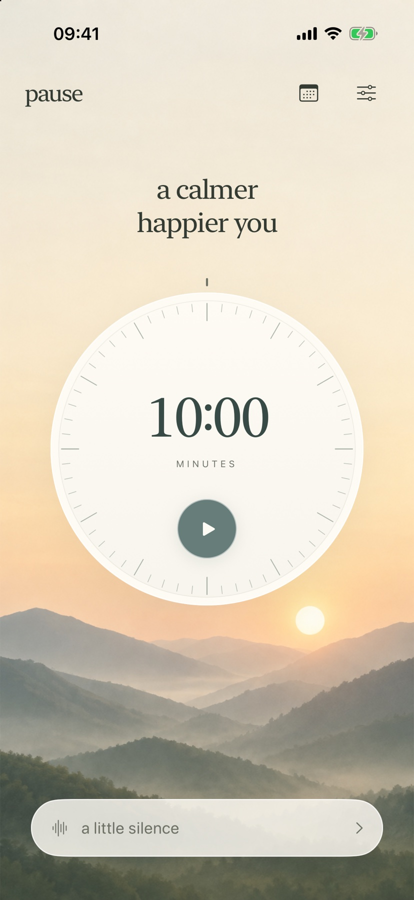
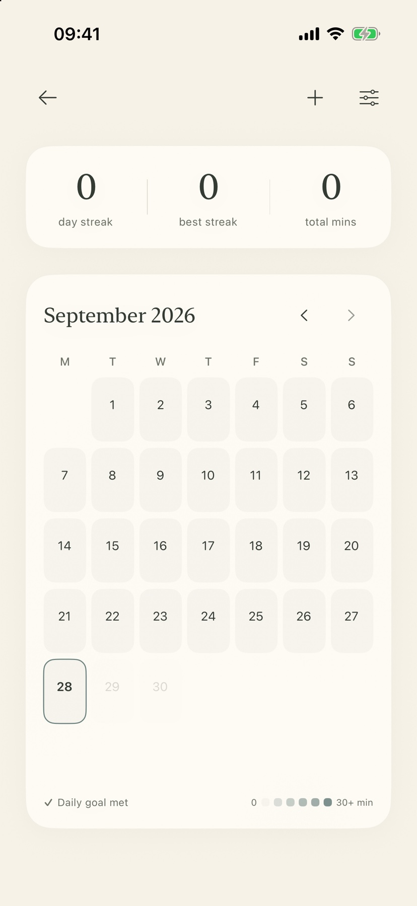

<p align="center">
  
</p>

<h1 align="center">Pause</h1>

<p align="center">
  A calm, offline-first meditation app for iPhone.<br>
  Designed and built by Mylo Michael with SwiftUI and SwiftData.
</p>

<p align="center">iOS 17+ &nbsp;·&nbsp; SwiftUI &nbsp;·&nbsp; SwiftData &nbsp;·&nbsp; No third-party dependencies</p>

## About

Pause makes it easy to begin a meditation and leave the rest of the day outside for a while. Set a duration with a tactile rotary dial, choose silence or an ambient sound, and settle into a focused session. A small journal keeps the history and reflections on the device.

The interface uses warm paper tones, muted sage, and generous space. During an active session, the screen fades to black and keeps the countdown and pause control in view.

## Features

- **Rotary timer:** choose from 0 to 180 minutes in one-minute steps, with haptic feedback and VoiceOver adjustment.
- **Resilient sessions:** pause and resume, recover an active timer after relaunch, and save or discard when ready. Meditation time continues past the planned end until the session is ended.
- **Offline sound:** original rain, ocean, and ambient loops with optional bell, bowl, or chime endings.
- **Practice journal:** monthly calendar, daily intentions, streaks, manual entries, and optional reflections.
- **Portable backups:** export or restore a versioned JSON backup. Imports are validated before merging with existing history.

## Screenshots

<table>
  <tr>
    <td align="center"><strong>Meditation</strong><br></td>
    <td align="center"><strong>Journal</strong><br><br><sub>Captured with an empty local history.</sub></td>
  </tr>
</table>

## Privacy

Pause works without an account or network connection. Sessions and reflections are stored locally with SwiftData; preferences and active-timer recovery data use UserDefaults. Backups are created only when exported by the user. The project includes no analytics SDKs or third-party packages.

## Build and run

1. Open `Pause.xcodeproj` in Xcode.
2. Select the **Pause** scheme and an iPhone simulator, then run.
3. To run on a physical iPhone, choose your own Apple development team in Signing & Capabilities.

The core model and business logic can also be exercised independently:

```sh
swift test
```

For the full iOS unit, persistence, and UI suite, choose **Product → Test** in Xcode with the **Pause** scheme. See [Validation](VALIDATION.md) for the last recorded results and known device-specific checks.

## Project structure

| Path | Purpose |
| --- | --- |
| `Pause/Core` | Portable records, timer, progress, backup, and dial logic |
| `Pause/Services` | SwiftData persistence, session orchestration, audio, and notifications |
| `Pause/Views` | Meditation, journal, settings, and shared visual styling |
| `Tests/PauseCoreTests` | Portable model and business-logic tests |
| `PauseUITests` | iOS persistence and interaction tests |
| `scripts` | Project generation, audio generation, and app-icon source |

The Xcode project is included. After changing the source-file list, regenerate it with `python3 scripts/generate_project.py`. The bundled audio can be recreated with `python3 scripts/generate_audio.py`.

## Notes

All sounds are generated from source in this repository and released under CC0-1.0; see [the audio notes](Pause/Resources/Audio/README.md). Ending a silent session with the screen locked uses an experimental background-audio approach and still needs broader physical-device verification. See [Validation](VALIDATION.md) for details.
